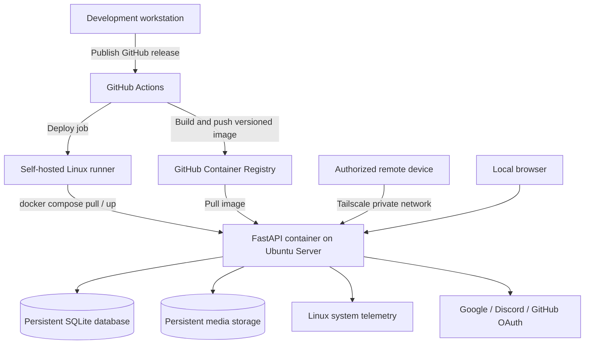

# Garage Sentinel 🗿

**A self-hosted personal cloud, built and operated end to end — from the physical Linux server to automated production releases.**

Garage Sentinel is my personal cloud storage and media management platform, powered by **Python/FastAPI**, deployed with **Docker Compose**, and hosted around the clock on a repurposed Ubuntu Server machine in my garage. It combines a browser-based photo/video library, authenticated accounts, live system telemetry, private remote access through **Tailscale**, and a release-driven **GitHub Actions CI/CD pipeline**.

This is more than a locally running demo: I maintain the underlying hardware, Linux environment, networking, persistent storage, application code, and deployment process. Published releases build container images in GitHub's hosted infrastructure and deploy them to my physical server using a self-hosted runner.

**Operational snapshot**

- **24/7-oriented self-hosting** on a dedicated Ubuntu Server machine, operated for **1–3 months** as of November 2026.
- **1–3 minute release-to-production deployments** observed in my environment.
- **Three OAuth providers:** Google, Discord, and GitHub.
- **Private remote access** to the application via Tailscale, without requiring public inbound application ports.
- **Automated pytest coverage** of authentication, user management, and administrative flows.

> **Project scope:** A personal, single-server cloud platform, not a claim of redundant/high-availability infrastructure or a commercially hosted SaaS product. Performance figures are observations from my deployment, not guaranteed benchmarks.

## Architecture



**Release flow:** Publish a non-prerelease GitHub release → build a Docker image → push `latest`, release-version, and commit-SHA tags to GHCR → deploy with Docker Compose on the self-hosted runner → verify the running service using an HTTP health check.

The workflow serializes production deployments to avoid overlapping release jobs. Unlike a push-to-main deployment, **production is triggered by publishing a release**.

## Features

### Personal cloud storage and media

- Upload and retrieve supported **PNG, JPG/JPEG, and MP4** files through FastAPI endpoints.
- Browse dedicated **photo and video galleries** from a web browser.
- Generate resized **JPEG thumbnails** with Pillow, including EXIF orientation handling.
- Separate human-readable filenames from **random 128-bit hexadecimal storage identifiers**.
- Persist file metadata in SQLite and file bytes in dedicated server storage.
- Validate file extensions and reject oversized uploads; the current code sets a **250 MiB** maximum constant (actual reverse-proxy and runtime limits may also apply).
- Clean up written files when a subsequent metadata operation fails.

### Authentication and account management

- Sign in with **Google, Discord, or GitHub** through Authlib OAuth integrations.
- Maintain signed, session-based authentication using Starlette middleware.
- Link multiple OAuth identities to an existing account, with checks to prevent linking a provider identity already owned by another user.
- Handle matching-email registration cases with a **pending-confirmation flow**, rather than silently merging accounts.
- Generate high-entropy registration tokens and store **SHA-256 hashes** instead of raw token values.
- Run a background task to clean up expired pending registrations.
- Provide user account management and **role-restricted administrative endpoints**.
- Record authentication and account activity in an activity log.

### Live server visibility

The `/api/telemetry` endpoint reads Linux system interfaces to report:

- CPU vendor, model, frequency, and temperature
- Total, available, and used memory, including utilization percentage
- System uptime and 15-minute load average

This gives the application visibility into the machine hosting it, rather than only the application process. Telemetry availability depends on the host/container environment exposing the relevant `/proc` and `/sys` paths.

### Remote access with Tailscale

Garage Sentinel is accessible remotely over my **Tailscale private network**, letting me reach my cloud storage while away from home. This provides a practical private-network access model without directly publishing the app's port to the public internet. OAuth redirect URIs must be configured to match the hostname and scheme used for access.

## Technology stack

| Layer | Technology |
| --- | --- |
| Backend | Python 3.12, FastAPI, Uvicorn, Pydantic |
| Authentication | Authlib OAuth, Starlette sessions |
| Persistence | SQLite, aiosqlite |
| Media processing | Pillow |
| Web UI | Server-served HTML/CSS/JavaScript |
| Containers | Docker, Docker Compose |
| CI/CD | GitHub Actions, GHCR, self-hosted Linux runner |
| Host / networking | Ubuntu Server, Tailscale |
| Testing | pytest, pytest-asyncio, FastAPI TestClient, mocked OAuth flows |

## Repository structure

```text
.
├── .github/workflows/docker-publish.yml  # Release-triggered build/deploy
├── Dockerfile                            # Python 3.12 application image
├── main.py                               # FastAPI application and router setup
├── config.py                             # Environment-based secrets/config
├── db/                                   # SQLite connection, schema, queries
├── models/                               # Typed application models
├── routes/                               # API and web-page routes
├── services/                             # Auth, files, users, admin logic
├── tasks/                                # Lifespan and registration cleanup
├── exceptions/                           # Custom HTTP error handling
├── static/                               # Static application assets
└── tests/                                # Authentication/user/admin tests
```

## API overview

| Method | Endpoint | Purpose |
| --- | --- | --- |
| `POST` | `/api/file` | Upload an authenticated user's file |
| `GET` | `/api/file/{storage_name}` | Retrieve original media or an image thumbnail |
| `GET` | `/api/photos` | List photos for the authenticated user |
| `GET` | `/api/videos` | List videos for the authenticated user |
| `GET` | `/api/telemetry` | Read Linux host telemetry |
| `GET` | `/api/auth/login/{provider}` | Start OAuth login |
| `GET` | `/api/auth/callback/{provider}` | Complete OAuth login |
| `POST` | `/api/auth/logout` | End the current session |
| `POST` | `/api/auth/registration/confirm` | Confirm pending registration |
| `GET` | `/api/users/me` | Get account information |
| `PATCH` | `/api/users/me/username` | Update username |
| `DELETE` | `/api/users/me` | Delete account |
| `GET` | `/api/admin/users` | List users (admin) |
| `GET` | `/api/admin/users/{user_id}` | Get a user (admin) |
| `DELETE` | `/api/admin/users/{user_id}` | Delete a user (admin) |

Web pages include `/`, `/login`, `/gallery`, `/clips`, `/account`, and `/documentation`. FastAPI also exposes interactive API documentation at `/docs` when enabled.

> **Security note:** The source currently serves stored media by opaque storage identifier without checking the requesting user's ownership on the retrieval endpoint. Treat storage URLs as bearer-style links; do **not** describe file access as fully private per user until authorization is enforced on reads. The telemetry endpoint is also not access-restricted in the current source.

## Running locally

**Prerequisites:** Python 3.12 recommended, a working Python environment, and OAuth applications configured for the callback URLs used in development.

```bash
python -m venv .venv
# Windows: .venv\Scripts\activate
# Linux/macOS:
source .venv/bin/activate
pip install -r requirements.txt
```

Create a `.env` file (never commit it):

```dotenv
SESSION_SECRET=replace-with-a-long-random-secret
GOOGLE_CLIENT_ID=your-google-client-id
GOOGLE_CLIENT_SECRET=your-google-client-secret
DISCORD_CLIENT_ID=your-discord-client-id
DISCORD_CLIENT_SECRET=your-discord-client-secret
GITHUB_CLIENT_ID=your-github-client-id
GITHUB_CLIENT_SECRET=your-github-client-secret
```

Start the app:

```bash
uvicorn main:app --reload
```

Open **http://127.0.0.1:8000**. The app initializes its SQLite schema at startup and starts the pending-registration cleanup task.

**Note:** The uploaded `requirements.txt` appears to have a malformed final dependency entry (`httpx2`). Correct the dependency list and include the testing dependencies (`pytest`, `pytest-asyncio`, `httpx`) before using the install/test commands in a fresh environment.

## Docker and production deployment

Build a local image:

```bash
docker build -t garage-sentinel:local .
```

For a useful persistent deployment, provide a valid `.env` and mount the application database and media directories. The production setup uses **Docker Compose** from `/srv/garage-sentinel` on the host; the Compose configuration is maintained on the server and is **not included in this repository archive**.

A typical deployment workflow is:

1. Publish a versioned GitHub release (for example, `v0.3.3`).
2. GitHub Actions builds and publishes image tags to `ghcr.io/casualcaleb/garage-sentinel`.
3. The self-hosted Linux runner executes `docker compose pull` and `docker compose up -d --no-build --remove-orphans`.
4. The workflow checks `docker compose ps` and retries an HTTP request to `http://localhost:8000/` to verify that the service responds.

The pipeline deploys from the **release event**, not every commit pushed to `main`. This separates ordinary development from production promotion.

## Testing

The test suite exercises user registration and login behavior, OAuth-related workflows, role-restricted administrative operations, and user management. Fixtures use temporary SQLite databases and mocked OAuth data to keep tests isolated from real accounts and production storage.

```bash
python -m pytest -q
```

The repository contains `tests/test_auth.py`, `tests/test_users.py`, and `tests/test_admin.py`. Test execution is **not currently a dedicated required job in the published GitHub Actions workflow**; the workflow builds and deploys. Adding a CI test gate before image publication is a logical next improvement.

## Engineering lessons and next steps

This project has been an exercise in owning the **entire operational path**: server provisioning, Linux administration, networking, environment secrets, application architecture, persistent storage, container releases, production troubleshooting, and remote access. Operating on repurposed hardware also makes resource constraints, monitoring, and recovery practical concerns rather than theoretical ones.

Potential next improvements include:

- Enforce per-user authorization on media retrieval and restrict sensitive telemetry.
- Add a required automated test job before publishing production images.
- Improve upload validation by enforcing byte limits while streaming and checking actual file contents.
- Introduce PostgreSQL when concurrency and application requirements justify migration.
- Add backup/restore procedures, stronger health checks, and deployment rollback support.
- Expand operational metrics and document recovery procedures for the physical server.

## About

Garage Sentinel is a personal engineering project built to turn an aging laptop into a useful, remotely accessible cloud service — and to explore what it takes to **build, ship, and operate software on infrastructure I manage myself**.

**Repository:** https://github.com/CasualCaleb/garage-sentinel
